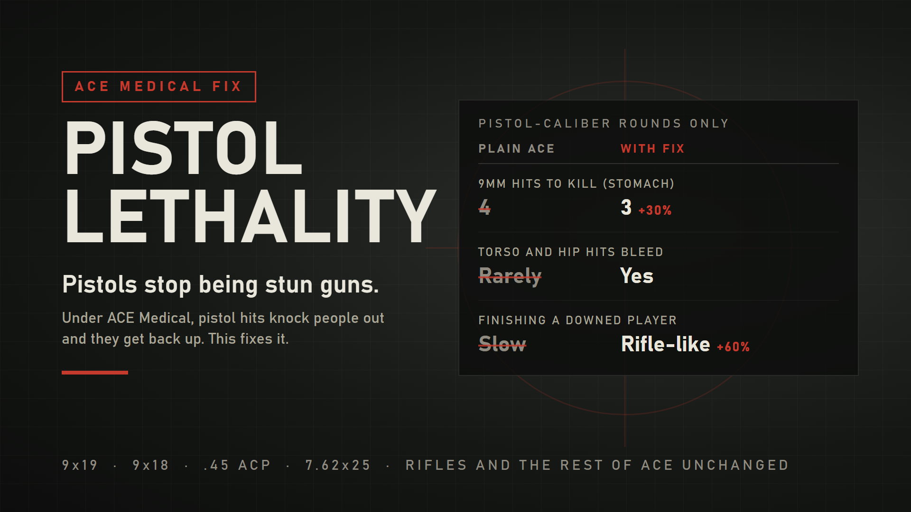

# Pistol Lethality (ACE Medical)



**Sidearms that actually put people down, on servers running ACE Medical.**

Author: **SyykoNT**

ACE Medical is a huge upgrade over the vanilla damage model, but most groups notice one side effect quickly: pistols stop killing people. Put a full magazine of 9mm into someone's torso and they end up on the ground in pain, then a minute later they get back up and shoot you. This addon fixes that for pistol-caliber rounds and leaves the rest of ACE as it is.

It was built for [COALITION](https://github.com/CoalitionArma) events and runs alongside the COALITION Reforger Framework, but it doesn't depend on it. Any server running ACE Medical can use it.

---

## Why pistols feel broken under ACE

ACE Medical Hitzones gets rid of the vanilla shared health pool. You die when a vital body part (head, chest, stomach or heart) is destroyed on its own, or when you bleed out.

A full-power rifle round destroys a stomach in one or two hits, and a 5.45 needs three. Most pistol rounds (9x19, 9x18, .45 ACP) need four or five. Worse, a single pistol hit almost never passes the threshold for a wound. Anything short of a kill causes pain and knocks people out, and since there's no wound to bleed from, the target just wakes up again later.

In practice that means a pistol under ACE is a stun gun.

## What changes

These rules only apply to rounds on the list:

| Situation | Plain ACE | With this addon |
|---|---|---|
| Stomach hit, for rounds that need 4 or more stomach hits | Normal damage | 30% more HP lost. Standard 9x19 ball and .45 now take 3 stomach hits instead of 4, the same as a 5.45 rifle. Rounds that already kill in 3 or fewer get no stomach bonus, so no pistol round out-kills a 5.45. |
| Chest or stomach hit on a downed player, after ACE Second Chance has run out | Normal damage | 60% more HP lost. Finishing someone off takes about as many rounds as it would with a rifle. |
| A hit that takes 10 HP or more off the chest, stomach or hips | Usually no wound | Starts a normal ACE bleed |

That's the whole change. Downed players still go down the way ACE intends, medics still have something to treat, and pistols are a real threat again.

## What it leaves alone

- **Every round that isn't on the list.** Rifles, machine guns, grenades, explosives, melee and vehicle weapons do exactly what they did before.
- **Armor.** Vests still stop pistol rounds. The extra damage is worked out from the HP the hit actually removed, after armor, so a round that a plate stops gets no bonus.
- **ACE's medical rules.** Heart one-shots, femoral and neck bleeds, headshots, cardiac arrest, the Second Chance window, knockout and collapsed lungs all work the same way.
- **Kill credit and hit effects.** The extra damage lands after the original hit has finished. Pain, knockout, the collapsed lung roll and kill credit all come from the original hit, and the shooter still gets the kill when the extra damage is what finishes someone.
- **Treatment.** Pistol wounds are normal ACE wounds. Tourniquets, bandages, chest seals, saline, epinephrine, CPR, ammonium carbonate and morphine all work on them.

## Requirements

- Arma Reforger 1.8
- **ACE Medical Hitzones Dev**, which also brings in ACE Medical Core Dev and ACE Core Dev. These are the same ACE builds the COALITION Reforger Framework runs on.

## Installation

### On a dedicated server

Add the mod to the `mods` list in your server config, next to your ACE mods:

```json
{
  "modId": "6DE298F3AB5669B8",
  "name": "Pistol Lethality (ACE Medical)"
}
```

### Next to the COALITION Reforger Framework

You don't need to change CRF or any mission. Load both addons together, for example in Workbench's Dedicated Server Tool:

```
-addons "COALITIONFramework,PistolLethality"
```

### From source

1. Clone this repository into your Workbench projects folder.
2. In the Arma Reforger Tools launcher, add `addon.gproj` as an existing project.
3. Open it. Workbench loads the ACE dependencies from your downloaded Workshop addons, so download them in the game first if you don't have them yet.

## Checking that it's running

The first time a bullet hits someone's torso on the server, the addon loads its config and writes one line to the server's script log:

```
[PistolLethality] Loaded 3 groups (2 enabled), 51 projectile prefabs. Master switch: 1
```

If the config can't be found, you get an error line starting with `[PistolLethality]` instead, and the addon stays out of the way.

## Configuration

All the numbers are in [`Configs/PistolLethality/SYK_PistolLethality.conf`](Configs/PistolLethality/SYK_PistolLethality.conf). Rounds are sorted into groups, and each group has its own rules.

| Setting | Pistol default | What it does |
|---|---|---|
| `m_bEnabled` (top level) | `1` | Master switch. `0` turns the whole addon off. |
| `m_bEnabled` (per group) | `1` | Turns one group on or off. |
| `m_aProjectilePrefabs` | 17 rounds | Projectile prefabs in the group. |
| `m_fChestMultiplier` | `1` | Total HP a chest hit removes, as a multiple of the original hit. `1` means unchanged. |
| `m_fAbdomenMultiplier` | `1.3` | The same for stomach hits. |
| `m_fDownedMultiplier` | `1.6` | Chest and stomach multiplier on a downed player once ACE Second Chance has run out. |
| `m_fWoundMinimumDamage` | `10` | A hit that removes at least this much HP from the chest, stomach or hips starts a bleed. A negative value turns this off. |

Three groups ship with the addon:

- **Pistol** (on, stomach +30%): rounds that need 4 or more stomach hits under plain ACE. Standard 9x19 ball and AP (M882, 7N21, M1154, Finest Hour 9x19, ARMA-RY 9x19), 9x18 ball, and the Finest Hour .45 ball.
- **Strong pistol rounds** (on, no stomach bonus): rounds that already kill in 3 stomach hits or fewer. Hot 9x19 loads (M1152, M1153, JHP, M1151, 7N15, 7N31, M1155 and the WCS tracers), 9x18 AP, 7.62x25 (including the Chungus Tokarev rounds), the Finest Hour .45 tracer, and the Chungus and ARMA-RY .45. They still get the bleed rule and the downed bonus. With the stomach bonus most of them would kill in 2 hits and out-kill a 5.45 rifle.
- **PDW** (off): 4.6x30 and 5.7x28. These sit between pistol and rifle rounds, so they're listed but switched off until they've been tested more.

Every listed round was sorted by measuring its stomach damage under plain ACE, so each one ends up at 3 stomach hits or more. Because each group has its own numbers, the same caliber from two different weapon packs can be tuned separately.

Rounds are matched by prefab path, so you can list rounds from any weapon mod without making that mod a dependency. Tracers and other variants that inherit from a listed round are picked up automatically.

### Changing the numbers

Treat the config like any other Reforger resource. Make a small addon that depends on this one, override `SYK_PistolLethality.conf` in it, and change whatever you need. Your values then survive updates to this addon.

## How it works

The addon is three script files and one config. It extends the game's character hit zone class (`SCR_CharacterHitZone`, which ACE Medical builds on) through a `modded class`, and every override calls the original first.

1. **Before the hit.** When a kinetic round strikes the chest, stomach or hips on the server, the addon checks which group the round's prefab belongs to (the answer is cached per prefab) and records the body part's HP.
2. **After the hit.** Once ACE and the game have fully processed the hit, it measures how much HP the hit really removed.
3. **Afterwards.** If that's over the wound minimum, it queues a normal ACE bleed on that body part. If a multiplier applies, it queues the extra HP loss, `(multiplier - 1) x damage dealt`, for the next update, so nothing interferes with the original hit.

All of the damage logic runs on the server. Clients just see the result through ACE's normal health and bleeding sync.

## Testing

Tested on a dedicated server running the COALITION Reforger Framework, by firing the same shots with the fix off and on:

- Every listed round (43 distinct prefabs) was fired at the chest, stomach and hips. Only the intended changes show up: one fewer stomach hit for the Pistol group, bleeding from solid torso and hip hits, and no stomach change for the strong rounds.
- Every rifle, machine gun and grenade case gives identical results with the fix off and on.
- ACE's own mechanics behave the same: heart one-shot, femoral and neck bleeds, headshots, cardiac arrest, the Second Chance window, knockout, collapsed lungs and grenades.
- Medics can treat pistol wounds the normal way, and every pistol cardiac arrest in testing was brought back with CPR.
- Kill credit goes to the shooter, including when the extra damage is what finishes the target.
- Vests still stop pistol rounds.
- It works at range. Pistols lose some damage out to 100 m, but every hit still starts a bleed.
- Every pistol and PDW round fired by a weapon or magazine in the CRF gearscripts is on the list (777 references traced to 213 rounds), and no rifle round is.
- Scripts compile for the PC, Xbox and PlayStation configurations, and the addon loads with only its ACE dependencies.

**Not tested yet:** a live server with a full player count. That covers the kill feed, AAR stats, team kills and players joining mid-mission. If you see something odd there, please open an issue.

## Reporting a problem

Open an issue on this repository with:

- the weapon and round you were using
- where the target was hit, and whether they were wearing armor
- what you expected to happen, and what happened instead
- your server's script log, if you can get it

## Credits

Made by **SyykoNT** for COALITION.

Built on top of ACE for Arma Reforger. All credit for the medical system itself goes to the ACE team.

## License

[MIT](LICENSE). Use it, change it, and ship it in your own packs. Just keep the copyright notice.
